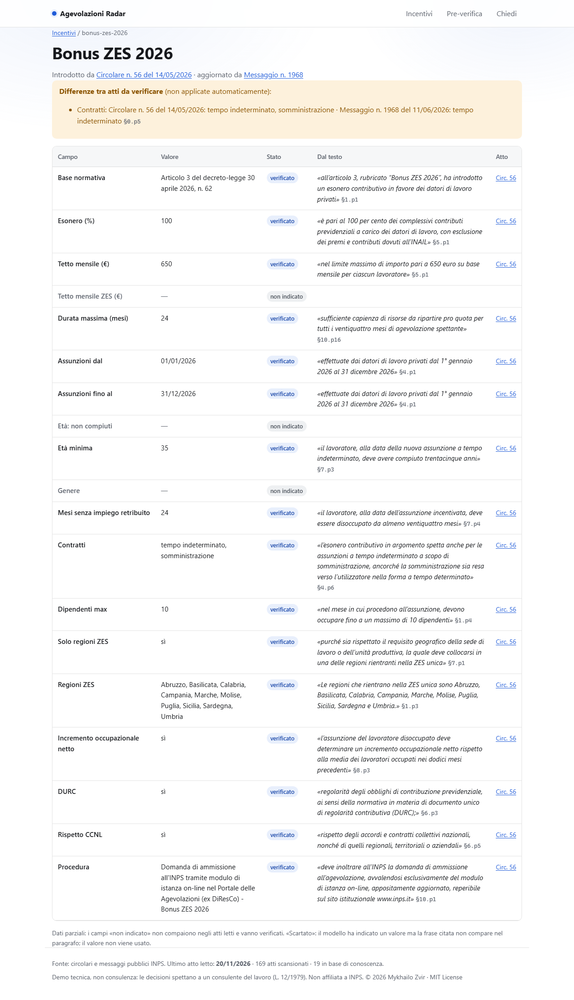

# Agevolazioni Radar

[](https://github.com/zvirmykhailo1987-cyber/agevolazioni-radar/actions/workflows/ci.yml)
[](LICENSE)

**Italian hiring incentives, read from the source.** A daily pipeline loads INPS circulars and messages, versions their text, and turns each incentive into a machine-readable rule. Every field carries the paragraph and the exact words it was read from: if those words are not in that paragraph, code drops the value. Agents query the knowledge base through an MCP server; people use a small web app.

> Technical demo, not advice. In Italy the final decision on payroll and contributions belongs to a *consulente del lavoro* (L. 12/1979); this system pre-screens and cites, it never decides. Not affiliated with INPS.



## Why it is built this way

Incentive rules change through a chain of acts: a decree, then a circular, then operating messages. News articles and secondary sources often get them wrong. Example from this corpus: secondary sources describe the 2026 ZES bonus differently, while circular 56 says the worker must have **reached** 35, the employer may have **at most 10** employees, and the ZES covers **ten** regions, Marche and Umbria included. A knowledge base for agents has to stand on the primary text, keep its versions, and say "not stated" instead of guessing.

## Pipeline

```
INPS public JSON ──dlt──▶ DuckDB raw ──dbt──▶ staging ▸ doc_versions (SCD2) ▸ incentive_documents
                                                         │
                     anchored paragraphs (§4.p2) ◀───────┘
                                │
         Claude, structured output ─▶ rules + quotes ─▶ citation gate (code) ─▶ consolidation across acts
                                │                                                   │
                 BM25 retrieval + grounded answers                       eligibility pre-check (code)
                                └────────────── MCP server · web app · evals ───────┘
```

| Step | What it does | Where |
|---|---|---|
| Load | `dlt` source over the two public JSON endpoints behind inps.it (paged listing, detail with full text). Each run re-reads the last 120 days, because INPS can correct an act after publication; a text row is appended only when its hash is new for that act. One request at a time, fixed delay, retries only on 429/5xx; robots.txt allows these paths. Dates are converted in Europe/Rome time, because UTC puts every act one day early. | [inps_source.py](src/radar/inps_source.py) |
| Model | `dbt` on DuckDB (Snowflake in production would be a profile change): staging views, a version table where a new text hash means a new version (SCD2), and the knowledge-base input. Source freshness on load time: warn after 2 days, error after 4. 12 dbt tests, plus an end-to-end pytest that corrects a circular between two loads and expects version 2. | [dbt/](dbt/) |
| Paragraphs | INPS HTML to numbered paragraphs. Only bold numbered lines start a section, so the table of contents is not mistaken for content. | [text.py](src/radar/text.py) |
| Extraction | Claude fills a strict JSON schema through structured outputs. The prompt says "null if not stated". Results are cached by (text hash, prompt version, model), so a quiet day costs nothing. | [extract.py](src/radar/extract.py), [llm.py](src/radar/llm.py) |
| Citation gate | A value survives only if its quote (4+ whole words) is in the cited paragraph **and** the quote states that value: the number as digits or an Italian number word, the date with day, month and year, each listed region by name. Otherwise it becomes *unverified* and is not used. The gate is re-applied to stored model output on every read, so tightening it costs no API calls. | [rules.py](src/radar/rules.py) |
| Consolidation | One incentive described by a circular and later messages becomes one rule. A later act fills fields the first one leaves out; a *different* value for a number, date, flag or list is shown for review and not applied. A message that does not mention something has not repealed it. | [consolidate.py](src/radar/consolidate.py) |
| Eligibility | Plain code, per criterion: pass / fail / unknown. Missing hire data, a condition the gate dropped, or an unresolved difference between acts all mean "to be checked", never "no" and never "passed". | [eligibility.py](src/radar/eligibility.py) |
| Q&A | BM25 (LangChain) over paragraphs, indexed together with each act's subject so "Bonus donne" routes to the right circular. The answer must cite; quotes are checked; every figure in the answer must appear in a cited paragraph (digits or number words); otherwise the answer becomes a refusal. | [rag.py](src/radar/rag.py) |
| MCP | `search_passages`, `list_incentives`, `get_incentive`, `check_eligibility`, `diff_versions`, `kb_status`. All read-only; stdio by default, HTTP only on loopback (no auth). | [mcp_server.py](src/radar/mcp_server.py) |
| Orchestration | Airflow DAG, weekdays 06:00 Europe/Rome: load, freshness, dbt build, paragraphs, extraction, eval alert. Each task is the same CLI a developer runs. The eval runs after the KB is written, so it alerts rather than blocks. | [airflow/dags/radar_daily.py](airflow/dags/radar_daily.py) |

## Measured (20 Nov 2026)

**Corpus.** 169 INPS acts published since 1 May 2026, 19 of them about incentives, 1,595 anchored paragraphs. 10 incentives after consolidation: the three 2026 bonuses (Giovani, ZES, Donne) are each described by a circular and a later message; for ZES and Donne one difference is flagged for review (the circular admits *somministrazione*, the later message does not mention it).

**Extraction.** 27 hand-labelled fields across circulars 55, 56 and 57, including fields that must stay empty: 27/27. With the stricter gate, 3 of the 150 values the model extracted across all acts are dropped as not grounded. Extracting all 19 acts costs about 281k input and 38k output tokens; the cache means a quiet day costs nothing.

**Grounded Q&A** ([golden set](evals/golden_qa.json)). 39 questions: 24 *dev* questions used while tuning retrieval and the prompt, 8 *holdout* questions written afterwards from circulars 72 and 82 and never used for tuning, 7 questions the sources cannot answer (2 of them on-topic near misses). Every question runs 3 times; scoring is on whole words.

| Metric (mean of 3 runs) | dev (24) | holdout (8) |
|---|---|---|
| Answer states the expected facts | 85% (83–88) | 75% (75–75) |
| A cited paragraph itself states those facts | 85% | 75% |
| Cites the hand-picked gold paragraph | 49% | 46% |
| Refuses when the sources do not say (7) | 100% | 100% |
| Citations rejected by the gate | 0 | 0 |

In all 3 runs, every answered question stated the expected facts. Every miss was a refusal ("not in the sources"), not a wrong answer. The misses are retrieval misses: the right paragraph is not in the top 10 (BM25). "Gold paragraph" is lower because INPS repeats the same rule in several sections, and the model often cites a different one that states the same facts.

Results are saved per run in [evals/results/](evals/results/). `radar-evals --baseline evals/results/baseline.json` exits non-zero if any mean metric, the extraction accuracy or the number of rejected citations gets worse. An earlier baseline ([baseline-v3-bm25.json](evals/results/baseline-v3-bm25.json)) used a looser substring scorer and only the dev questions, so its numbers are not comparable.

**Code.** 70 tests, offline: fake INPS over `httpx.MockTransport`, fake LLM, and a real dlt + dbt build in a temporary DuckDB. 97% line+branch coverage. Mutation check: 24/24 injected bugs caught ([docs/mutation-results.json](docs/mutation-results.json)). Each one removes a guarantee and a test must fail: the citation gate (quote, value, length, word boundaries), the 35th-birthday boundary, fail-closed eligibility, invented numbers next to a real quote, Rome dates, version dedup, the polite delay, the extraction cache, rate limits, the CSP header.

## Run it

```bash
python -m venv .venv && . .venv/bin/activate
pip install -e ".[dev]"
cp .env.example .env.local            # ANTHROPIC_API_KEY=... (needed for extraction, evals and live Q&A only)

radar-load --since 2026-05-01         # INPS -> DuckDB (data/radar.duckdb)
dbt build --project-dir dbt --profiles-dir dbt
radar-kb paragraphs && radar-kb extract
radar-evals --baseline evals/results/baseline.json
radar-web                             # http://localhost:8040
radar-mcp                             # MCP over stdio, e.g. for Claude Desktop / Claude Code
pytest                                # no network, no API key needed
```

## Known limits

- The corpus starts in May 2026 and covers INPS only; laws in Gazzetta Ufficiale and CCNL texts are not loaded yet.
- `incentive_id` is chosen by the model; consolidation relies on the same incentive getting the same id across acts. Today it does for all three bonuses; a mismatch would show up as two separate incentives, not as a wrong merge. A production version needs a canonical registry of incentives with human-approved aliases.
- Retrieval is lexical. It is enough for this vocabulary and corpus size, and the eval names the questions where it misses.
- The web demo limits live questions (per IP per hour, per IP per day, and globally per day). It trusts `X-Forwarded-For` only from `FORWARDED_ALLOW_IPS`, the reverse proxy.
- Unresolved differences between acts are shown on the incentive page and turn the pre-check into "to be checked"; there is no in-app workflow to resolve them yet.
- Dependencies are pinned in `requirements.lock` (used as pip constraints in Docker and CI).

## License

[MIT](LICENSE) © 2026 Mykhailo Zvir
